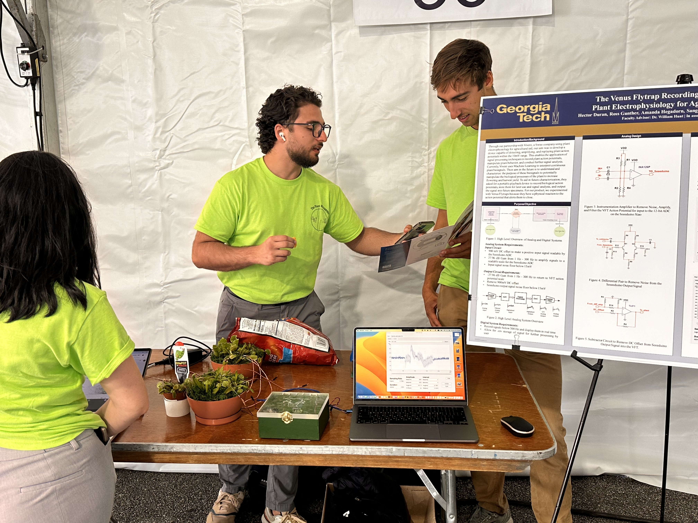
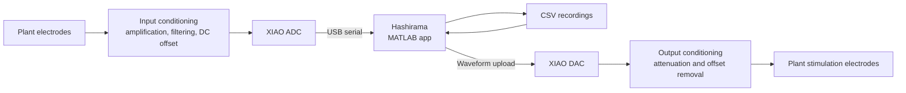
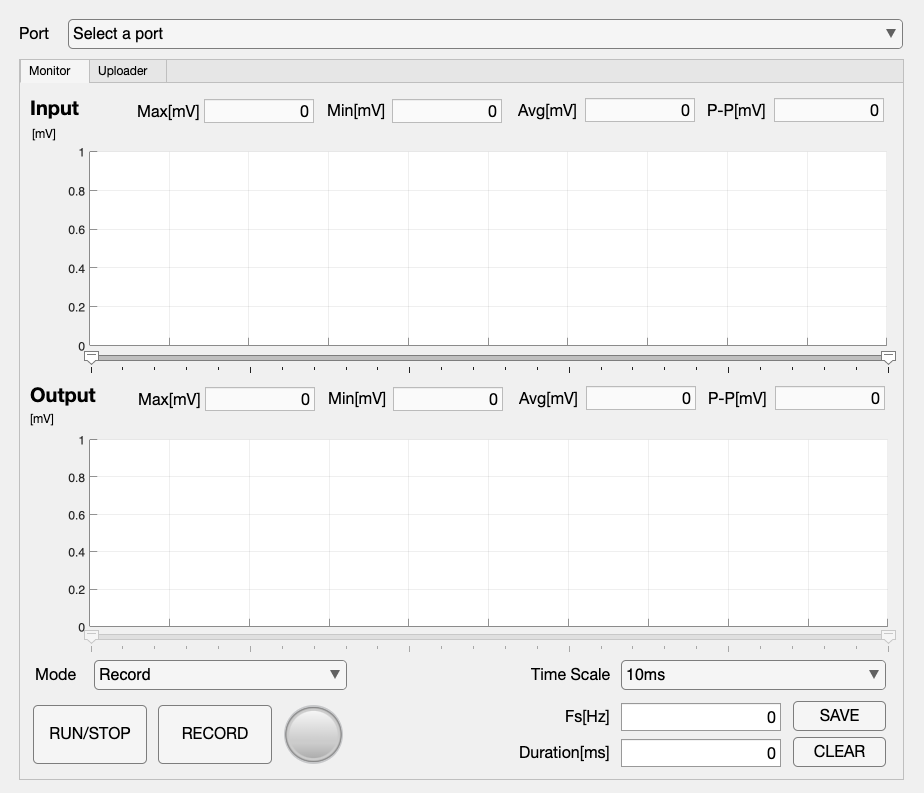
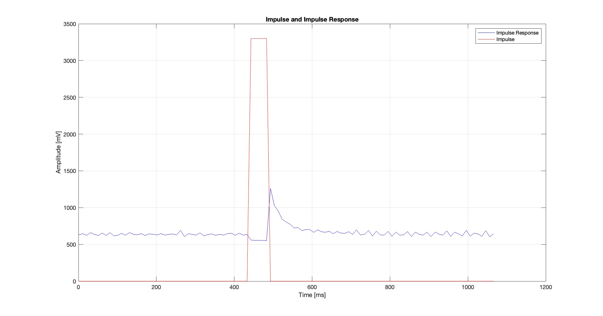
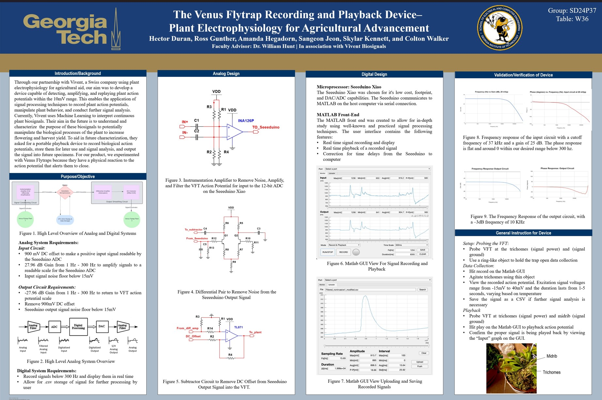

# The Venus Flytrap Recording and Playback Device

**Plant Electrophysiology for Agricultural Advancement**

Georgia Tech · ECE 4723 Senior Design · Spring 2024 · Group SD24P37

A system for recording and replaying electrical signals in Venus flytraps. The project combines a MATLAB App Designer interface, Seeeduino XIAO firmware, and analog signal conditioning to capture plant action potentials, save measurements as CSV files, and replay selected waveforms for stimulation experiments.

## Project video and final materials

| Resource | Link |
| --- | --- |
| Project explanation video | [Watch on YouTube — 5:19](https://youtu.be/vUATFXuZiM0) |
| Final project poster | [View the poster](docs/poster/venus-flytrap-recording-playback-poster.jpeg) |
| Final presentation | [Download the PowerPoint, including speaker notes](docs/presentation/final-presentation.pptx) |



*The device, plant setup, and project poster at the senior design fair.*

## Final product

The two files at the root are the final software deliverables:

| File | Role |
| --- | --- |
| [Hashirama.mlapp](Hashirama.mlapp) | MATLAB application: serial connection, live input/output plots, recording, CSV import/export, waveform selection and upload. |
| [Senju.cpp](Senju.cpp) | Seeeduino XIAO firmware: ADC acquisition, DAC playback, waveform buffering, pulse generation, and serial command handling. |

The MATLAB application contains its own control and data-handling code. The scripts in `archive/` document earlier development and are not required to launch it.

## How it works

Venus flytraps provide a visible way to investigate plant electrophysiology: stimulating their trigger hairs produces electrical activity associated with trap closure. The project explores capturing those signals and applying recorded waveforms back to a plant.



The analog front end makes small plant signals readable by the microcontroller. The output stage scales playback signals and removes the DC offset before stimulation. Circuit diagrams and the original design discussion are in the [poster](docs/poster/venus-flytrap-recording-playback-poster.jpeg) and [presentation](docs/presentation/final-presentation.pptx).

## MATLAB interface



*Preview embedded in the final App Designer file. Earlier interface screenshots are retained in [media/screenshots/](media/screenshots/).*

- **Monitor:** `Record`, `Playback`, `Record & Playback`, and `Impulse Response` modes; input/output plots, time-scale controls, selection cursors, and signal statistics.
- **Recording and export:** capture a recording or save a selected interval as CSV.
- **Uploader:** load a CSV waveform, select a segment, resample it, and send it to the device for playback.

## Getting started

You need MATLAB with App Designer, a Seeeduino XIAO with the matching analog circuitry and electrodes, and a board-compatible Arduino toolchain. The firmware depends on the external `CircularBuffer.h` library. The repository preserves the firmware source, but does not include the board package, library, or a complete hardware build configuration.

1. Configure the toolchain for the original XIAO hardware and build/flash [Senju.cpp](Senju.cpp). See [implementation notes](docs/implementation-notes.md) for pins and dependencies.
2. Connect the device over USB. Open this repository as MATLAB's current folder.
3. Run the application:

   ```matlab
   Hashirama
   ```

4. Select the device's serial port. The app and firmware communicate at **9600 baud**.
5. In **Monitor**, select a mode and press **RUN/STOP** to start acquisition or playback. Press **RECORD** to begin recording; press it again to stop and choose a CSV save location.
6. For waveform playback, use **Uploader → Search** to load a CSV, optionally select a range, and press **Upload**. Return to **Monitor**, select `Playback` or `Record & Playback`, and press **RUN/STOP**.

CSV files use `Time` in milliseconds and `Volt_In` and/or `Volt_Out` in millivolts at the device interface. These values include the analog conditioning; they are not automatically calibrated to the original plant-electrode voltage. See [results/](results/README.md) for recorded examples and measurement context.

## Results and supporting material

| Location | Contents |
| --- | --- |
| [results/](results/README.md) | Device measurements, impulse-response plots, and 10–100 Hz digital verification captures. |
| [docs/](docs/README.md) | Project poster, presentation, implementation notes, and the original-to-current file map. |
| [media/](media/README.md) | Project fair, hardware, bench-test and team photos; earlier GUI screenshots; classified original MOV recordings. |
| [archive/](archive/README.md) | Earlier MATLAB scripts, RTOS experiments, development/reference datasets, autosave backups, and preserved repository metadata. |

Original MOV footage is stored with Git LFS. See the [media guide](media/README.md#video-collection) for download instructions.



*Recorded pulse/response example. The original data is retained in [results/measured-data/](results/measured-data/).*

The application was checked to launch and close in MATLAB R2026a. This does not establish current end-to-end hardware performance. The preserved firmware has known buffer and timing limitations, documented in [implementation notes](docs/implementation-notes.md); the original presentation's design targets should not be read as guarantees for every operating mode.

## Final project poster

[](docs/poster/venus-flytrap-recording-playback-poster.jpeg)

Open the poster for the full-resolution view, or download the [final presentation](docs/presentation/final-presentation.pptx) for the slide-by-slide explanation and speaker notes.

## Team

Hector Duran · Ross Gunther · Amanda Hegadorn · Sangeon Jeon · Skylar Kennett · Colton Walker

**Faculty advisor:** Dr. William Hunt

**In association with:** Vivent Biosignals

Project context and credits follow the original poster and presentation. The linked [explanation video](https://youtu.be/vUATFXuZiM0) presents the project walkthrough.
