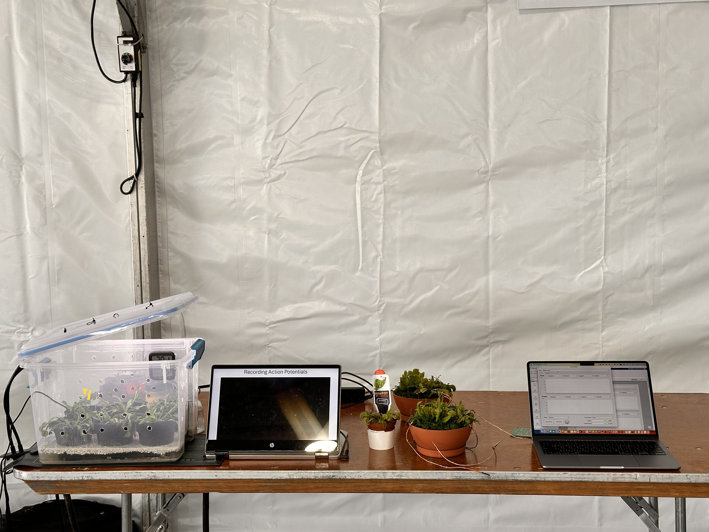
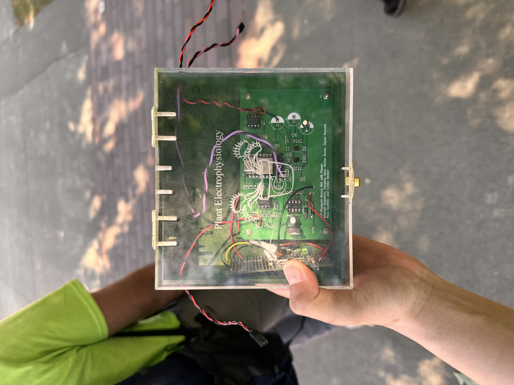
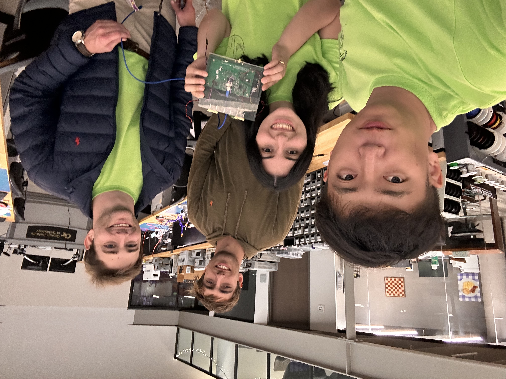

# Photos and original video

[Watch the project explanation video](https://youtu.be/vUATFXuZiM0) for the public walkthrough, or download the [complete presentation MP4](videos/presentations/final-project-presentation-and-demo.mp4). This folder preserves the original project photos, early interface screenshots, raw MOV recordings, and final presentation video.

## Photo collection

| Folder | Contents |
| --- | --- |
| [photos/project-fair/](photos/project-fair/) | Booth setup, enclosed device closeups, team at the booth, and visitor demonstrations at the senior design fair. |
| [photos/bench-testing/](photos/bench-testing/) | MATLAB traces, oscilloscope comparisons, frequency-response measurement, and waveform-generator settings. |
| [photos/hardware/](photos/hardware/) | Enclosed device on the lab bench. |
| [photos/team/](photos/team/) | Team photos in the lab and photos with the assembled device. |
| [screenshots/](screenshots/) | Earlier `Record` and `Playback` UI screenshots. The final app preview is in [docs/images/](../docs/images/). |



*Project fair demonstration setup.*



*The assembled device at the fair.*



*Team photo with the device.*

## Video collection

All **20 original MOV clips** are retained, totaling approximately **9 minutes 42 seconds** and **743 MiB**, together with the **5-minute 19-second final presentation MP4**. The 21 retained videos were named and classified without trimming, re-encoding, or changing their contents.

| Folder | Clips | Subject |
| --- | --- | --- |
| [videos/bench-testing/](videos/bench-testing/) | 10 | MATLAB monitor/uploader controls, waveform selection, playback displays, and connected bench hardware. |
| [videos/plant-experiments/](videos/plant-experiments/) | 9 | Plant/electrode setup, signal-monitor demonstrations, and device-induced Venus flytrap closure demonstrations. |
| [videos/project-fair/](videos/project-fair/) | 1 | Assembled device and laptop demonstration at the project display table. |
| [videos/presentations/](videos/presentations/) | 1 | Complete final presentation, covering the project background, requirements, system architecture, circuits, MATLAB interface, plant experiments, and conclusions. |

### Final presentation

[final-project-presentation-and-demo.mp4](videos/presentations/final-project-presentation-and-demo.mp4) is the complete **318.8-second** presentation, originally named `Senior Design Project Demo.mp4`.

The separate `Record_2024_05_30_11_57_47_740.mp4` was a **102.434-second opening excerpt** of the same presentation. Matching slide progression and approximately 100 seconds of aligned audio confirmed the overlap. The redundant excerpt was removed; the complete presentation is preserved byte-for-byte. Both original filenames and their disposition are recorded in the [file map](../docs/file-map.csv).

### Device-induced flytrap closure

The project team confirmed that these two recordings show Venus flytraps closing in response to stimulation from the project's own device:

| Clip | Duration | Contents |
| --- | --- | --- |
| [venus-flytrap-observation-01.mov](videos/plant-experiments/venus-flytrap-observation-01.mov) | 18.5 seconds | Device-induced Venus flytrap closure, demonstration 1. |
| [venus-flytrap-observation-02.mov](videos/plant-experiments/venus-flytrap-observation-02.mov) | 9.0 seconds | Device-induced Venus flytrap closure, demonstration 2. |

Both are also featured in the [main README](../README.md#demonstration-closing-a-venus-flytrap-with-our-device). Their existing filenames are retained, with their confirmed experimental meaning recorded here and in the video index.

The [video index](video-index.csv) gives each clip's original filename, current path, duration, resolution, description, and classification confidence. Initial classification used start/middle/end frame samples; the project team subsequently identified the two closure demonstrations above. The project-fair clip was grouped from its visible display setup and surrounding photo context.

The largest original MOV is approximately 122 MiB. All retained MOV and MP4 recordings are tracked with **Git LFS**, preserving the full files while storing small pointers in ordinary Git history. Install Git LFS before cloning or contributing. To fetch the footage in an existing clone:

```sh
git lfs install
git lfs pull
```

The application, firmware, photos, results, and documentation can be used independently of the raw-video download.

## Naming and provenance

Names describe visible subjects rather than phone-camera sequence IDs. Suffixes such as `-01` and `-02` distinguish similar views. The repository-wide [file map](../docs/file-map.csv) maps original names to current names, records SHA-256 checksums, and identifies intentionally removed duplicates. The 20 original MOV clips and complete presentation MP4 remain unchanged.
